<!-- Fichier généré par scripts/build.py à partir de skills.json : modifier skills.json, pas ce fichier. -->

# - About me -

I'm **LugolBis**, a French computer science student passionate about building reliable data systems and exploring modern technologies.

My main interests are **Data Engineering**, **Data Quality**, and **Rust**.

## 🌐 Profiles

  &nbsp;
  <a href="https://huggingface.co/LugolBis" title="Hugging Face"><picture>
    <source media="(prefers-color-scheme: dark)" srcset="https://raw.githubusercontent.com/LugolBis/LugolBis/main/assets/icons/huggingface-dark.svg">
    
  </picture></a>

# - Tech Stack -

## Programming Languages

  <b>Advanced</b> 
  <a href="https://rust-lang.org/" title="Rust"><picture>
    <source media="(prefers-color-scheme: dark)" srcset="https://raw.githubusercontent.com/LugolBis/LugolBis/main/assets/icons/rust-dark.svg">
    
  </picture></a>&nbsp;
  <a href="https://python.org/" title="Python"><picture>
    <source media="(prefers-color-scheme: dark)" srcset="https://raw.githubusercontent.com/LugolBis/LugolBis/main/assets/icons/python-dark.svg">
    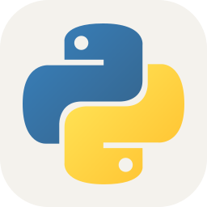
  </picture></a>&nbsp;
  <a href="https://www.oracle.com/database/technologies/appdev/plsql.html" title="PL/SQL"><picture>
    <source media="(prefers-color-scheme: dark)" srcset="https://raw.githubusercontent.com/LugolBis/LugolBis/main/assets/icons/plsql-dark.svg">
    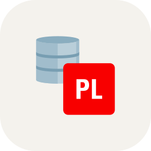
  </picture></a>&nbsp;
  <a href="https://www.java.com/" title="Java"><picture>
    <source media="(prefers-color-scheme: dark)" srcset="https://raw.githubusercontent.com/LugolBis/LugolBis/main/assets/icons/java-dark.svg">
    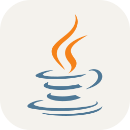
  </picture></a> 
  <a href="https://rust-lang.org/">Rust</a> · <a href="https://python.org/">Python</a> · <a href="https://www.oracle.com/database/technologies/appdev/plsql.html">PL/SQL</a> · <a href="https://www.java.com/">Java</a>

  <b>Proficient</b> 
  <a href="https://www.scala-lang.org/" title="Scala"><picture>
    <source media="(prefers-color-scheme: dark)" srcset="https://raw.githubusercontent.com/LugolBis/LugolBis/main/assets/icons/scala-dark.svg">
    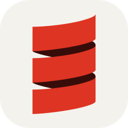
  </picture></a>&nbsp;
  <a href="https://www.gnu.org/software/bash/" title="Bash"><picture>
    <source media="(prefers-color-scheme: dark)" srcset="https://raw.githubusercontent.com/LugolBis/LugolBis/main/assets/icons/bash-dark.svg">
    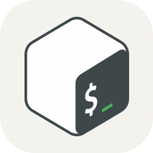
  </picture></a>&nbsp;
  <a href="https://learn.microsoft.com/powershell/" title="PowerShell"><picture>
    <source media="(prefers-color-scheme: dark)" srcset="https://raw.githubusercontent.com/LugolBis/LugolBis/main/assets/icons/powershell-dark.svg">
    
  </picture></a>&nbsp;
   
  <a href="https://www.scala-lang.org/">Scala</a> · <a href="https://www.gnu.org/software/bash/">Bash</a> · <a href="https://learn.microsoft.com/powershell/">PowerShell</a> · <a href="https://developer.mozilla.org/docs/Web/JavaScript">JavaScript</a>

  <b>Intermediate</b> 
  &nbsp;
  <a href="https://developer.mozilla.org/docs/Web/CSS" title="CSS">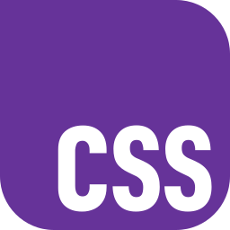</a>&nbsp;
  <a href="https://www.r-project.org/" title="R"><picture>
    <source media="(prefers-color-scheme: dark)" srcset="https://raw.githubusercontent.com/LugolBis/LugolBis/main/assets/icons/r-dark.svg">
    
  </picture></a> 
  <a href="https://developer.mozilla.org/docs/Web/HTML">HTML</a> · <a href="https://developer.mozilla.org/docs/Web/CSS">CSS</a> · <a href="https://www.r-project.org/">R</a>

## Data Engineering

  <b>Relational Databases (SQL)</b> 
  <a href="https://www.oracle.com/database/" title="Oracle"><picture>
    <source media="(prefers-color-scheme: dark)" srcset="https://raw.githubusercontent.com/LugolBis/LugolBis/main/assets/icons/oracle-dark.svg">
    
  </picture></a>&nbsp;
  <a href="https://postgresql.org/" title="PostgreSQL"><picture>
    <source media="(prefers-color-scheme: dark)" srcset="https://raw.githubusercontent.com/LugolBis/LugolBis/main/assets/icons/postgresql-dark.svg">
    
  </picture></a>&nbsp;
  <a href="https://mysql.com/" title="MySQL"><picture>
    <source media="(prefers-color-scheme: dark)" srcset="https://raw.githubusercontent.com/LugolBis/LugolBis/main/assets/icons/mysql-dark.svg">
    
  </picture></a>&nbsp;
  <a href="https://duckdb.org/" title="DuckDB">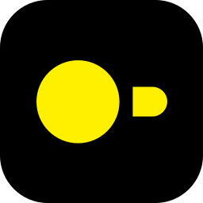</a> 
  <a href="https://www.microsoft.com/sql-server/" title="SQL Server"><picture>
    <source media="(prefers-color-scheme: dark)" srcset="https://raw.githubusercontent.com/LugolBis/LugolBis/main/assets/icons/sqlserver-dark.svg">
    
  </picture></a>&nbsp;
  &nbsp;
  <a href="https://www.pingcap.com/" title="TiDB"><picture>
    <source media="(prefers-color-scheme: dark)" srcset="https://raw.githubusercontent.com/LugolBis/LugolBis/main/assets/icons/tidb-dark.svg">
    
  </picture></a> 
  <a href="https://www.oracle.com/database/">Oracle</a> · <a href="https://postgresql.org/">PostgreSQL</a> · <a href="https://mysql.com/">MySQL</a> · <a href="https://duckdb.org/">DuckDB</a> · <a href="https://www.microsoft.com/sql-server/">SQL Server</a> · <a href="https://sqlite.org/">SQLite</a> · <a href="https://www.pingcap.com/">TiDB</a>

  <b>Processing</b> 
  <a href="https://spark.apache.org/" title="Spark"><picture>
    <source media="(prefers-color-scheme: dark)" srcset="https://raw.githubusercontent.com/LugolBis/LugolBis/main/assets/icons/spark-dark.svg">
    
  </picture></a>&nbsp;
  <a href="https://kafka.apache.org/" title="Kafka">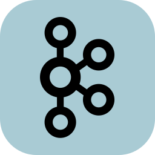</a>&nbsp;
  <a href="https://www.getdbt.com/" title="dbt"><picture>
    <source media="(prefers-color-scheme: dark)" srcset="https://raw.githubusercontent.com/LugolBis/LugolBis/main/assets/icons/dbtlabs-dark.svg">
    
  </picture></a>&nbsp;
   
  <a href="https://spark.apache.org/">Spark</a> · <a href="https://kafka.apache.org/">Kafka</a> · <a href="https://www.getdbt.com/">dbt</a> · <a href="https://pola.rs/">Polars</a>

  <b>NoSQL</b> 
  <a href="https://neo4j.com/" title="Neo4j"><picture>
    <source media="(prefers-color-scheme: dark)" srcset="https://raw.githubusercontent.com/LugolBis/LugolBis/main/assets/icons/neo4j-dark.svg">
    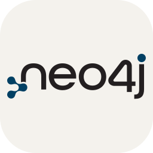
  </picture></a> 
  <a href="https://neo4j.com/">Neo4j</a>

  <b>Orchestration</b> 
  <a href="https://airflow.apache.org/" title="Apache Airflow"><picture>
    <source media="(prefers-color-scheme: dark)" srcset="https://raw.githubusercontent.com/LugolBis/LugolBis/main/assets/icons/airflow-dark.svg">
    
  </picture></a> 
  <a href="https://airflow.apache.org/">Apache Airflow</a>

  <b>Cloud</b> 
  <a href="https://cloud.google.com/" title="Google Cloud Platform"><picture>
    <source media="(prefers-color-scheme: dark)" srcset="https://raw.githubusercontent.com/LugolBis/LugolBis/main/assets/icons/gcp-dark.svg">
    
  </picture></a> 
  <a href="https://cloud.google.com/">Google Cloud Platform</a>

  <b>Lakehouse</b> 
  <a href="https://www.dremio.com/" title="Dremio">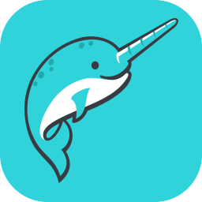</a> 
  <a href="https://www.dremio.com/">Dremio</a>

## DevOps / Tooling

  <b>Containers</b> 
  &nbsp;
  <a href="https://www.virtualbox.org/" title="VirtualBox"><picture>
    <source media="(prefers-color-scheme: dark)" srcset="https://raw.githubusercontent.com/LugolBis/LugolBis/main/assets/icons/virtualbox-dark.svg">
    
  </picture></a> 
  <a href="https://docker.com/">Docker</a> · <a href="https://www.virtualbox.org/">VirtualBox</a>

  <b>CI/CD &amp; Testing</b> 
  <a href="https://github.com/features/actions" title="GitHub Actions"><picture>
    <source media="(prefers-color-scheme: dark)" srcset="https://raw.githubusercontent.com/LugolBis/LugolBis/main/assets/icons/githubactions-dark.svg">
    
  </picture></a>&nbsp;
  <a href="https://pages.github.com/" title="GitHub Pages"><picture>
    <source media="(prefers-color-scheme: dark)" srcset="https://raw.githubusercontent.com/LugolBis/LugolBis/main/assets/icons/githubpages-dark.svg">
    
  </picture></a>&nbsp;
  <a href="https://docs.pytest.org/en/stable/" title="Pytest"><picture>
    <source media="(prefers-color-scheme: dark)" srcset="https://raw.githubusercontent.com/LugolBis/LugolBis/main/assets/icons/pytest-dark.svg">
    
  </picture></a> 
  <a href="https://github.com/features/actions">GitHub Actions</a> · <a href="https://pages.github.com/">GitHub Pages</a> · <a href="https://docs.pytest.org/en/stable/">Pytest</a>

  <b>Version Control</b> 
  <a href="https://git-scm.com/" title="Git"><picture>
    <source media="(prefers-color-scheme: dark)" srcset="https://raw.githubusercontent.com/LugolBis/LugolBis/main/assets/icons/git-dark.svg">
    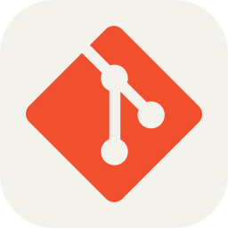
  </picture></a>&nbsp;
  <a href="https://github.com/" title="GitHub"><picture>
    <source media="(prefers-color-scheme: dark)" srcset="https://raw.githubusercontent.com/LugolBis/LugolBis/main/assets/icons/github-dark.svg">
    
  </picture></a>&nbsp;
  <a href="https://gitlab.com/" title="GitLab"><picture>
    <source media="(prefers-color-scheme: dark)" srcset="https://raw.githubusercontent.com/LugolBis/LugolBis/main/assets/icons/gitlab-dark.svg">
    
  </picture></a> 
  <a href="https://git-scm.com/">Git</a> · <a href="https://github.com/">GitHub</a> · <a href="https://gitlab.com/">GitLab</a>

  <b>Build Tools</b> 
  <a href="https://maven.apache.org/" title="Maven"><picture>
    <source media="(prefers-color-scheme: dark)" srcset="https://raw.githubusercontent.com/LugolBis/LugolBis/main/assets/icons/maven-dark.svg">
    
  </picture></a> 
   
  <a href="https://maven.apache.org/">Maven</a> · <a href="https://docs.astral.sh/uv/">uv</a>

## AI

  <b>ML/DL</b> 
  <a href="https://tensorflow.org/" title="TensorFlow"><picture>
    <source media="(prefers-color-scheme: dark)" srcset="https://raw.githubusercontent.com/LugolBis/LugolBis/main/assets/icons/tensorflow-dark.svg">
    
  </picture></a>&nbsp;
  <a href="https://pytorch.org/" title="PyTorch"><picture>
    <source media="(prefers-color-scheme: dark)" srcset="https://raw.githubusercontent.com/LugolBis/LugolBis/main/assets/icons/pytorch-dark.svg">
    
  </picture></a> 
  <a href="https://tensorflow.org/">TensorFlow</a> · <a href="https://pytorch.org/">PyTorch</a>

  <b>DS Libs</b> 
  <a href="https://pandas.pydata.org/" title="Pandas"><picture>
    <source media="(prefers-color-scheme: dark)" srcset="https://raw.githubusercontent.com/LugolBis/LugolBis/main/assets/icons/pandas-dark.svg">
    
  </picture></a>&nbsp;
  <a href="https://numpy.org/" title="NumPy"><picture>
    <source media="(prefers-color-scheme: dark)" srcset="https://raw.githubusercontent.com/LugolBis/LugolBis/main/assets/icons/numpy-dark.svg">
    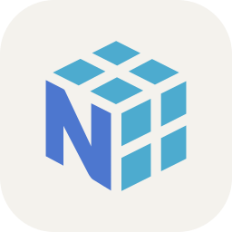
  </picture></a> 
  <a href="https://pandas.pydata.org/">Pandas</a> · <a href="https://numpy.org/">NumPy</a>

  <b>LLM Ops</b> 
  <a href="https://huggingface.co/" title="Hugging Face"><picture>
    <source media="(prefers-color-scheme: dark)" srcset="https://raw.githubusercontent.com/LugolBis/LugolBis/main/assets/icons/huggingface-dark.svg">
    
  </picture></a>&nbsp;
  <a href="https://ollama.com/" title="Ollama"><picture>
    <source media="(prefers-color-scheme: dark)" srcset="https://raw.githubusercontent.com/LugolBis/LugolBis/main/assets/icons/ollama-dark.svg">
    
  </picture></a> 
  <a href="https://huggingface.co/">Hugging Face</a> · <a href="https://ollama.com/">Ollama</a>

## Visualization

  <b>Charts</b> 
  <a href="https://matplotlib.org/" title="Matplotlib"><picture>
    <source media="(prefers-color-scheme: dark)" srcset="https://raw.githubusercontent.com/LugolBis/LugolBis/main/assets/icons/matplotlib-dark.svg">
    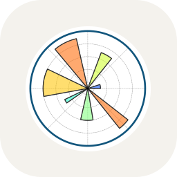
  </picture></a>&nbsp;
  <a href="https://plotly.com/" title="Plotly"><picture>
    <source media="(prefers-color-scheme: dark)" srcset="https://raw.githubusercontent.com/LugolBis/LugolBis/main/assets/icons/plotly-dark.svg">
    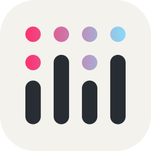
  </picture></a> 
  <a href="https://matplotlib.org/">Matplotlib</a> · <a href="https://plotly.com/">Plotly</a>

  <b>Diagrams</b> 
  &nbsp;
   
  <a href="https://mermaid.js.org/">Mermaid</a> · <a href="https://miro.com/">Miro</a>

  <b>Documentation</b> 
  <a href="https://www.markdownguide.org/" title="Markdown"><picture>
    <source media="(prefers-color-scheme: dark)" srcset="https://raw.githubusercontent.com/LugolBis/LugolBis/main/assets/icons/markdown-dark.svg">
    
  </picture></a>&nbsp;
  <a href="https://latex-project.org/" title="LaTeX"><picture>
    <source media="(prefers-color-scheme: dark)" srcset="https://raw.githubusercontent.com/LugolBis/LugolBis/main/assets/icons/latex-dark.svg">
    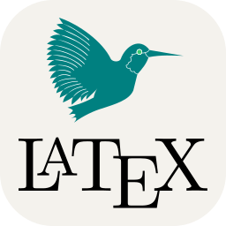
  </picture></a>&nbsp;
  <a href="https://typst.app/" title="Typst"><picture>
    <source media="(prefers-color-scheme: dark)" srcset="https://raw.githubusercontent.com/LugolBis/LugolBis/main/assets/icons/typst-dark.svg">
    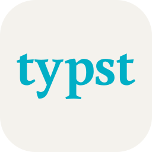
  </picture></a> 
  <a href="https://www.markdownguide.org/">Markdown</a> · <a href="https://latex-project.org/">LaTeX</a> · <a href="https://typst.app/">Typst</a>

## Applications / Frameworks

  <b>Data Apps</b> 
  <a href="https://pydantic.dev/" title="Pydantic"><picture>
    <source media="(prefers-color-scheme: dark)" srcset="https://raw.githubusercontent.com/LugolBis/LugolBis/main/assets/icons/pydantic-dark.svg">
    
  </picture></a>&nbsp;
  <a href="https://streamlit.io/" title="Streamlit"><picture>
    <source media="(prefers-color-scheme: dark)" srcset="https://raw.githubusercontent.com/LugolBis/LugolBis/main/assets/icons/streamlit-dark.svg">
    
  </picture></a>&nbsp;
  <a href="https://gradio.app/" title="Gradio"><picture>
    <source media="(prefers-color-scheme: dark)" srcset="https://raw.githubusercontent.com/LugolBis/LugolBis/main/assets/icons/gradio-dark.svg">
    
  </picture></a> 
  <a href="https://pydantic.dev/">Pydantic</a> · <a href="https://streamlit.io/">Streamlit</a> · <a href="https://gradio.app/">Gradio</a>

  <b>Web</b> 
   
  <a href="https://flask.palletsprojects.com/">Flask</a>

  <b>Scraping</b> 
   
  <a href="https://www.crummy.com/software/BeautifulSoup/">Beautiful Soup</a>

  <b>Rust Ecosystem</b> 
  <a href="https://ratatui.rs/" title="Ratatui"><picture>
    <source media="(prefers-color-scheme: dark)" srcset="https://raw.githubusercontent.com/LugolBis/LugolBis/main/assets/icons/ratatui-dark.svg">
    
  </picture></a> 
  &nbsp;
  &nbsp;
   
  <a href="https://ratatui.rs/">Ratatui</a> · <a href="https://macroquad.rs/">Macroquad</a> · <a href="https://dioxuslabs.com/">Dioxus</a> · <a href="https://github.com/emilk/egui">egui</a>

## Operating System

  <b>Proficient</b> 
  <a href="https://cachyos.org/" title="CachyOS"><picture>
    <source media="(prefers-color-scheme: dark)" srcset="https://raw.githubusercontent.com/LugolBis/LugolBis/main/assets/icons/cachyos-dark.svg">
    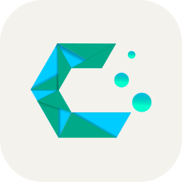
  </picture></a>&nbsp;
  <a href="https://www.microsoft.com/windows" title="Windows"><picture>
    <source media="(prefers-color-scheme: dark)" srcset="https://raw.githubusercontent.com/LugolBis/LugolBis/main/assets/icons/windows-dark.svg">
    
  </picture></a>&nbsp;
  <a href="https://apple.com/macos/" title="Apple"><picture>
    <source media="(prefers-color-scheme: dark)" srcset="https://raw.githubusercontent.com/LugolBis/LugolBis/main/assets/icons/apple-dark.svg">
    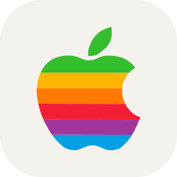
  </picture></a>&nbsp;
  &nbsp;
   
  <a href="https://cachyos.org/">CachyOS</a> · <a href="https://www.microsoft.com/windows">Windows</a> · <a href="https://apple.com/macos/">Apple</a> · <a href="https://system76.com/pop/">Pop!_OS</a> · <a href="https://ubuntu.com/server">Ubuntu Server</a>

## Office

  <b>Proficient</b> 
  <a href="https://www.microsoft.com/microsoft-365/excel" title="Excel"><picture>
    <source media="(prefers-color-scheme: dark)" srcset="https://raw.githubusercontent.com/LugolBis/LugolBis/main/assets/icons/excel-dark.svg">
    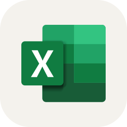
  </picture></a>&nbsp;
  <a href="https://www.microsoft.com/microsoft-teams/group-chat-software" title="Microsoft Teams"><picture>
    <source media="(prefers-color-scheme: dark)" srcset="https://raw.githubusercontent.com/LugolBis/LugolBis/main/assets/icons/teams-dark.svg">
    
  </picture></a>&nbsp;
  <a href="https://www.microsoft.com/microsoft-365/powerpoint" title="PowerPoint"><picture>
    <source media="(prefers-color-scheme: dark)" srcset="https://raw.githubusercontent.com/LugolBis/LugolBis/main/assets/icons/powerpoint-dark.svg">
    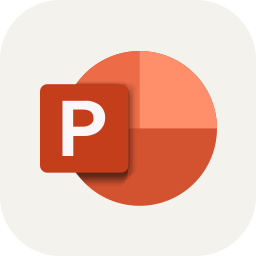
  </picture></a> 
  <a href="https://www.microsoft.com/microsoft-365/excel">Excel</a> · <a href="https://www.microsoft.com/microsoft-teams/group-chat-software">Microsoft Teams</a> · <a href="https://www.microsoft.com/microsoft-365/powerpoint">PowerPoint</a>

## IDEs / Editors

  <b>Advanced</b> 
  <a href="https://code.visualstudio.com/" title="Visual Studio Code"><picture>
    <source media="(prefers-color-scheme: dark)" srcset="https://raw.githubusercontent.com/LugolBis/LugolBis/main/assets/icons/vscode-dark.svg">
    
  </picture></a>&nbsp;
  <a href="https://vscodium.com/" title="VSCodium"><picture>
    <source media="(prefers-color-scheme: dark)" srcset="https://raw.githubusercontent.com/LugolBis/LugolBis/main/assets/icons/vscodium-dark.svg">
    
  </picture></a> 
  <a href="https://code.visualstudio.com/">Visual Studio Code</a> · <a href="https://vscodium.com/">VSCodium</a>

  <b>Intermediate</b> 
  &nbsp;
  <a href="https://jupyter.org/" title="Jupyter Notebook"><picture>
    <source media="(prefers-color-scheme: dark)" srcset="https://raw.githubusercontent.com/LugolBis/LugolBis/main/assets/icons/jupyter-dark.svg">
    
  </picture></a>&nbsp;
  <a href="https://replit.com/" title="Replit"><picture>
    <source media="(prefers-color-scheme: dark)" srcset="https://raw.githubusercontent.com/LugolBis/LugolBis/main/assets/icons/replit-dark.svg">
    
  </picture></a>&nbsp;
  <a href="https://sublimetext.com/" title="Sublime Text"><picture>
    <source media="(prefers-color-scheme: dark)" srcset="https://raw.githubusercontent.com/LugolBis/LugolBis/main/assets/icons/sublime-dark.svg">
    
  </picture></a> 
   · <a href="https://jupyter.org/">Jupyter Notebook</a> · <a href="https://replit.com/">Replit</a> · <a href="https://sublimetext.com/">Sublime Text</a>

